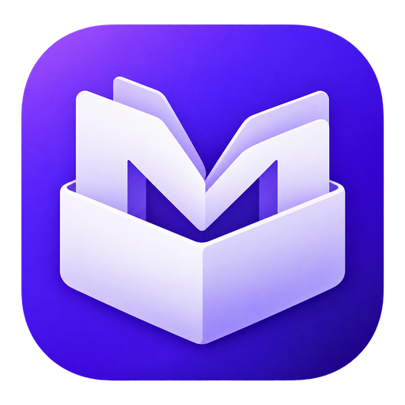

<p align="center">
  
</p>

<h1 align="center">모아함 · Moaham</h1>
<p align="center"><strong>영감부터 업무 문서까지, 한곳에 모아두는 나만의 자료함.</strong></p>
<p align="center">
  <a href="https://github.com/mycodehive/Moaham/releases/latest">Windows 설치 파일 다운로드</a> ·
  <a href="#업데이트-기록">업데이트 기록</a> ·
  <a href="#처음-사용하기">사용 안내</a>
</p>

## 모아함을 소개합니다

**모아함(Moaham)**은 디자인 자료와 문서 파일을 함께 정리하는 Windows용 개인 파일 관리 프로그램입니다. 이미지·디자인 소스부터 PDF·업무 문서·영상까지, 여러 폴더에 흩어진 자료를 보관함에 모으고 폴더·태그·메모로 정리해 다시 찾아보세요.

왼쪽에서 분류를 고르고, 가운데 갤러리에서 자료를 살펴보고, 오른쪽에서 미리보기와 상세정보를 확인합니다. 가입이나 별도 서버 없이 내 컴퓨터에서 사용할 수 있으며, 파일을 가져오면 **원본을 유지한 채 보관함에 복사**합니다. 자료 정리·검색·미리보기는 오프라인에서도 사용할 수 있습니다. 새 버전 확인과 다운로드에는 인터넷이 필요합니다.

### 이런 작업에 활용하세요

- **디자인 자료 정리:** 참고 이미지, 로고, 디자인 소스에 프로젝트·스타일 태그를 붙여 관리합니다.
- **업무 문서 보관:** 보고서, 계약서, 회의 자료를 폴더와 태그로 분류하고 메모를 남깁니다.
- **개인 자료 수집:** 학습 자료, 아이디어, 자주 쓰는 파일을 즐겨찾기에 모아둡니다.

## 주요 기능

| 기능 | 할 수 있는 일 |
|---|---|
| 통합 보관함 | 이미지·디자인 소스·문서·영상 등 일반 파일을 한곳에 보관 |
| 폴더와 태그 | 하위 폴더, 복수 폴더 분류, 태그·메모·별점으로 정리 |
| 빠른 검색 | 파일명·제목·태그·메모·추출 가능한 문서 본문 검색 |
| 미리보기 | 이미지·PDF·텍스트·문서 추출 본문과 지원되는 영상·오디오 확인 |
| 보기 설정 | 갤러리·목록 전환, 파일 카드 크기 조절 및 마지막 크기 기억 |
| 즐겨찾기 | 자주 찾는 폴더와 파일을 따로 모아 바로 접근 |
| 앱 잠금 | 비밀번호 설정·변경·해제, 즉시 잠금, 실행 시 비밀번호 확인 |
| 중복 감지 | 내용이 같은 파일의 중복 저장 방지. 같은 이름의 다른 파일은 별도 보관 |
| 복원과 백업 | 휴지통·복원, 선택 파일 내보내기, 파일과 분류 정보를 포함한 전체 백업 |
| 앱 업데이트 | 새 버전 알림, 승인 후 다운로드, 다시 확인 후 재시작 설치 |

## 설치하기

1. **[최신 배포 페이지](https://github.com/mycodehive/Moaham/releases/latest)**에서 `Moaham-Setup-1.4.0-x64.exe`를 다운로드합니다.
2. 실행 중인 Moaham 또는 이전 orgFiles를 종료한 뒤 설치 파일을 실행합니다.
3. 설치 위치를 선택하고, 바탕화면 또는 시작 메뉴에서 **Moaham**을 실행합니다.

Windows 10/11 **64비트(x64)**용입니다. Node.js·Python·별도 서버를 설치할 필요가 없습니다. 현재 설치본은 Windows 코드 서명이 없어 SmartScreen 안내가 표시될 수 있습니다. 공식 배포 경로와 함께 제공되는 `SHA256SUMS.txt`로 파일을 확인할 수 있습니다.

**v1.2.0 이하 사용자는 v1.3.0을 한 번 직접 설치해야 합니다.** 이후 새 버전부터 앱 안에서 업데이트할 수 있습니다. 기존 보관함·비밀번호·즐겨찾기·메모·태그·카드 크기를 이어서 사용합니다.

## 처음 사용하기

1. **자료 가져오기:** 파일·폴더 가져오기 버튼을 누르거나 파일을 앱으로 끌어다 놓습니다.
2. **자동 유형 분류:** 어떤 유형 화면에서 가져와도 파일 확장자에 따라 자동 분류합니다. 한 유형은 해당 화면으로, 여러 유형은 모든 파일로 이동합니다. 기존 검색어는 지워 가져온 자료를 바로 보여줍니다.
3. **분류하기:** 폴더 옆 ＋로 폴더를 만들고 파일 상세의 폴더 편집에서 분류를 지정합니다. 한 파일을 여러 폴더로 분류할 수 있습니다.
4. **기록하기:** 파일을 선택해 제목·태그·메모·별점을 입력하고 **변경사항 저장**을 누릅니다. 태그는 `계약서, 연구, 2026`처럼 쉼표로 구분합니다.
5. **다시 찾기:** 검색창과 파일 유형 필터, 즐겨찾기를 사용합니다. 공백으로 나눈 검색어는 모두 포함하는 자료를 찾습니다.
6. **백업하기:** ⚙ → **전체 백업 만들기**로 보관 파일과 분류 정보를 함께 복사합니다.

### 내 작업 방식에 맞추기

- **카드 크기:** 검색창 옆 − / 슬라이더 / ＋로 140~360px 범위에서 조절합니다. 미리보기 높이도 함께 바뀌며 재실행 후에도 유지됩니다.
- **폴더 즐겨찾기:** 폴더 옆 ☆ 또는 오른쪽 클릭 메뉴에서 등록합니다. 왼쪽 **즐겨찾는 폴더**에 바로가기가 생깁니다.
- **파일 즐겨찾기:** 카드의 ☆ / ★ 또는 파일 상세의 즐겨찾기 버튼을 사용합니다. **즐겨찾는 파일**에서 모아 봅니다.
- **비밀번호:** ⚙ → **앱 비밀번호 설정**에서 설정합니다. 변경·해제 시 현재 비밀번호가 필요하며 상단에서 즉시 잠글 수 있습니다. 5회 불일치하면 30초 동안 재시도가 제한됩니다.
- **백업 열기:** ⚙ → **다른 보관함 / 전체 백업 열기**에서 백업 폴더를 선택합니다. 기존 자료와 병합하지 않고 별도 보관함으로 엽니다.

앱 비밀번호는 **앱 접근 잠금**입니다. 파일 자체를 암호화하거나 Windows 탐색기에서의 접근을 막지 않습니다. 비밀번호 복구 기능은 없으며, 보관함 백업에는 앱 비밀번호 설정이 포함되지 않습니다.

### 자주 쓰는 단축키

| 단축키 | 동작 |
|---|---|
| Ctrl+O / Ctrl+K | 파일 가져오기 / 검색 |
| Ctrl+클릭 / Shift+클릭 | 여러 파일 선택 / 범위 선택 |
| Ctrl+A | 현재 검색 결과 전체 선택 |
| Space / Enter | 미리보기 / 연결 프로그램으로 열기 |
| Delete / Esc | 휴지통으로 이동 / 선택 해제 |

## 미리보기와 지원 형식

| 파일 형식 | 앱 안에서 확인하는 내용 |
|---|---|
| JPG·PNG·GIF·WebP·SVG·BMP·AVIF·ICO | 이미지 |
| PDF | PDF 뷰어. 환경에 따라 연결 프로그램 사용 |
| TXT·MD·CSV·TSV·JSON·코드 | 텍스트와 본문 검색 |
| DOCX·XLSX·PPTX·HWPX·ODT·ODS·ODP | 추출한 텍스트와 추출 본문 검색 |
| MP4·WebM / MP3·WAV·OGG 등 | 실행 환경의 코덱이 지원하는 영상·오디오 재생 |
| HWP·DOC·XLS·PPT·PSD·AI·FIG·ZIP 등 | 파일 보관·분류·검색, OS 지원 시 섬네일, 연결 프로그램으로 열기 |

문서 텍스트 미리보기는 원본 서식·이미지·도표·수식을 재현하지 않습니다. 원본 모양은 연결 프로그램에서 확인하세요. PDF 본문 추출, 이미지 OCR, 클라우드 동기화, AI 자동 분류, Eagle 라이브러리 가져오기는 현재 지원하지 않습니다. 실행 파일·스크립트·바로가기는 보관할 수 있으나 앱에서 실행하지 못하도록 제한합니다.

## 앱에서 업데이트하기

v1.3.0부터 앱 실행 약 10초 후와 실행 중 4시간마다 정식 GitHub Release를 확인합니다. 잠금 상태에서는 확인을 미루며, 잠금 해제 후 다시 확인합니다. ⚙ → **앱 업데이트 확인** 또는 도움말 → **업데이트 확인**에서도 확인할 수 있습니다.

1. 새 버전 알림에서 **다운로드**를 선택하고 승인합니다.
2. 다운로드 진행률을 확인합니다. 설치 파일의 SHA512 검사가 실패하면 설치하지 않으며 재시도할 수 있습니다.
3. 완료 후 **재시작하고 설치**를 승인하면 앱을 종료하고 업데이트한 뒤 다시 실행합니다.

**다운로드와 재시작 설치는 각각 사용자 확인 후 진행합니다.** 나중에를 선택하면 현재 버전을 계속 사용할 수 있습니다. 일반 종료만으로 설치하지 않으며, 앱 잠금 또는 파일 작업 중에는 설치를 차단합니다.

개발자가 소스 파일만 바꾼 상태가 아니라, **새 버전 설치 파일이 정식 Release로 게시되었을 때** 업데이트를 안내합니다.

## 환경설정과 오른쪽 클릭 메뉴

파일 카드나 목록 행에서 **오른쪽 클릭**하면 미리보기, 연결 프로그램 열기, 탐색기 보기, 제목 변경, 즐겨찾기, 태그·폴더 편집, 내보내기, 휴지통 작업을 사용할 수 있습니다. 선택한 파일을 오른쪽 클릭하면 다중 선택을 유지합니다. 휴지통에서는 복원·영구 삭제가 표시됩니다. 키보드의 메뉴 키 또는 Shift+F10, 방향키·Enter·Esc로도 사용할 수 있습니다.

⚙ **Moaham 환경설정 → 오른쪽 클릭 메뉴 설정**에서 항목을 켜거나 끄고 위·아래 버튼으로 순서를 바꿀 수 있습니다. 모두 숨겨도 메뉴 설정 항목은 표시되며 기본값으로 복원할 수 있습니다.

⚙ **화면 색상 · 라이트 / 다크**에서 모드를 선택하고 배경·사이드바 및 패널·파일 카드·본문 및 보조 글자·강조색·테두리 색상을 직접 지정하세요. 모드별 색상을 따로 저장하고, 저장 전 실시간 미리보기·취소·기본 색상 복원을 지원합니다. 설정은 현재 Windows 사용자의 앱 프로필에 저장되어 재실행 후 유지됩니다.

## 업데이트 기록

### v1.4.0 · 나에게 맞는 메뉴와 화면

- 파일 갤러리와 목록에 단일·다중 선택 및 휴지통 상태를 지원하는 오른쪽 클릭 메뉴를 추가했습니다.
- 환경설정에 메뉴 표시 항목·순서 설정과 기본값 복원을 추가했습니다.
- 라이트·다크 모드와 모드별 사용자 색상, 실시간 미리보기·취소·저장을 추가했습니다.
- 화면의 이전 보관함 이름 표시를 Moaham으로 통일하고 보관함 위치 열기를 제공합니다.
- 탐색·파일 유형·도구 모음 아이콘을 SVG 아이콘으로 통일하고 빈 화면·하단에도 Moaham 로고를 적용했습니다.
- 앱·실행 파일·설치 프로그램 아이콘을 통일하고 이전 이름의 Windows 바로가기를 정리합니다.
- 메뉴·테마 저장 및 재실행, 다중 선택·복원, 잠금 중 메뉴와 데이터 접근 차단을 Windows에서 검증합니다.


### v1.3.1 · 끌어놓기 수정과 유형별 자동 분류 안내

- 탐색기에서 끌어놓은 파일 목록이 전달 과정에서 비어 가져오지 못하던 오류를 수정했습니다.
- 어느 파일 유형 화면에 놓거나 가져오더라도 파일 확장자로 유형을 자동 판별합니다.
- 한 가지 유형은 해당 유형 화면으로, 여러 유형은 모든 파일 화면으로 이동해 가져온 결과를 바로 보여줍니다.
- 가져오기 후 기존 검색어를 지워 새 파일이 검색 필터에 가려지지 않도록 했습니다.
- 사용자 폴더에서 가져오면 해당 폴더 분류를 유지하며 유형도 자동 판별합니다.
- 실제 파일 경로 끌어놓기, 폴더 끌어놓기, 유형이 다른 파일·혼합 유형·중복 파일·잠금 중 차단을 회귀 검증합니다.


### v1.3.0 · 사용자 승인 기반 자동 업데이트

- 정식 GitHub Release의 새 버전 확인과 앱 내 알림을 추가했습니다.
- 사용자 승인 후 다운로드, 진행률 표시, 재시작 설치 전 재확인을 추가했습니다.
- 설정과 도움말에서 수동으로 업데이트를 확인할 수 있습니다.
- 인터넷 오류 재시도, SHA512 검사, 잠금·파일 작업 중 설치 차단을 적용했습니다.
- 실제 Windows 설치본에서 다운로드·설치 거절, 손상 파일 차단과 재시도, NSIS 업데이트 및 기존 데이터 유지를 검증했습니다.
- Windows 업데이트 검증 스크립트의 모듈 접근 오류를 수정했습니다.
- README를 로고, 프로그램 소개, 사용 안내와 버전별 업데이트 기록 중심으로 정리했습니다.

### v1.2.0 · orgFiles에서 모아함으로

- 앱과 GitHub 저장소 이름을 **Moaham**으로 변경했습니다.
- 자료를 담는 함과 M을 결합한 보라색 아이콘을 적용했습니다.
- 앱 화면·잠금 화면·창 제목·실행 파일·설치 파일·바로가기를 새 이름으로 통일했습니다.
- 이전 orgFiles의 비밀번호·보관함·즐겨찾기·카드 크기와 백업 호환성을 유지했습니다.

### v1.1.0 · 나에게 맞는 보관함

- 앱 비밀번호 설정·변경·해제 및 즉시 잠금을 추가했습니다.
- 파일 카드 크기를 조절하고 마지막 크기를 기억하도록 개선했습니다.
- 폴더 즐겨찾기 바로가기를 추가하고 파일 즐겨찾기 사용성을 개선했습니다.
- 잠금 중 데이터 접근과 잠금 전에 시작한 요청의 뒤늦은 처리를 차단했습니다.

### v1.0.0 · 첫 Windows 버전

- 디자인·문서 통합 보관, 갤러리·목록 보기와 폴더·태그·메모·별점 관리를 제공했습니다.
- 파일·문서 본문 검색, 미리보기, 중복 감지와 휴지통·복원을 추가했습니다.
- 선택 파일 내보내기와 전체 백업, Windows 설치본 배포를 제공했습니다.

## 자료는 어디에 저장되나요?

새 설치의 기본 보관함은 Windows **문서 폴더의 `Moaham Library`**입니다. 기존 사용자는 `orgFiles Library` 또는 직접 지정한 보관함을 이어서 사용합니다. 설정에서 여러 보관함을 만들거나 전환할 수 있습니다.

보관함에는 파일 복사본, 목록·폴더·태그·메모·검색용 텍스트와 미리보기 캐시가 저장됩니다. 선택 파일 내보내기는 파일만 복사하며, 전체 백업은 분류 정보까지 함께 복사합니다. 같은 이름의 파일은 번호를 붙여 내보내 기존 파일을 덮어쓰지 않습니다.

휴지통에서 복원할 수 있으며, 영구 삭제는 보관함의 복사본에만 적용됩니다. 폴더 삭제는 분류만 없애고 파일을 유지합니다. 설치 제거 후에도 사용자 보관함은 유지됩니다. 같은 보관함을 여러 앱·컴퓨터에서 동시에 수정하거나 실행 중 내부 파일을 직접 편집하지 마세요.

앱 설정은 새 설치에서 `%APPDATA%/Moaham/`에 저장됩니다. 기존 `%APPDATA%/orgFiles/` 또는 `%APPDATA%/orgfiles/`가 있으면 해당 경로를 그대로 사용합니다.

<details>
<summary><strong>개발·빌드·검증 안내</strong></summary>

## 개발 언어와 구조

**JavaScript + Electron**을 사용합니다. HTML/CSS로 화면을 만들고 Electron의 메인 프로세스가 Windows 파일시스템·파일 선택창·연결 프로그램을 처리합니다. 네이티브 SDK를 따로 배울 필요가 적고 Windows 설치본에 실행 환경을 함께 포함할 수 있어 첫 데스크톱 프로젝트에 선택했습니다.

```text
src/brand.cjs      # 이전 설정·보관함 경로 호환
src/auth.cjs       # scrypt 비밀번호·시도 제한·앱 잠금
src/main.cjs       # Electron 창·프로토콜·검증된 IPC·네이티브 작업
src/preload.cjs    # 화면에 공개하는 기능별 브리지
src/library.cjs    # 복사·해시·분류·순차 저장·백업
src/extract.cjs    # 크기 제한을 적용한 문서 XML/텍스트 추출
src/formats.cjs    # 유형·미리보기·외부 실행 제한
src/index.html     # 한국어 3열 화면
src/app.js         # 탐색·검색·편집·미리보기
src/styles.css    # 독립적인 다크 UI
```

Node.js 22 이상을 설치한 후:

```powershell
git clone https://github.com/mycodehive/Moaham.git
cd Moaham
npm ci
npm start
npm test
npm run test:ui
npm run dist:win
```

결과: `dist/Moaham-Setup-1.4.0-x64.exe`. 배포는 **Windows 환경의 GitHub Actions**가 담당합니다. main/PR에 테스트·빌드를 수행합니다. main에서 해당 버전의 Release가 없으면 `v{버전}` 태그와 설치본·SHA-256을 Releases에 게시하며, `v*` 태그 빌드도 지원합니다. 다음 배포는 package.json 버전을 올린 뒤 main에 반영하세요. `MOAHAM_LIBRARY` 환경변수로 테스트용 보관함 경로를 지정할 수 있습니다. 개발용 화면 테스트는 별도의 임시 앱 설정 폴더를 사용합니다.

보안은 [Electron 공식 권고](https://www.electronjs.org/docs/latest/tutorial/security)에 따라 context isolation·renderer sandbox·CSP·IPC 송신자 검사·별도 파일 미리보기 origin·허용 형식 프로토콜을 적용합니다. 설치 패키징은 [electron-builder NSIS](https://www.electron.build/nsis/)를 사용합니다. 로컬 JSON 목록은 소규모 개인 보관함용이며 대규모 자료(수만~수십만 파일)는 SQLite 인덱스·백그라운드 처리로 확장하는 것이 적합합니다.

## 검증

`npm test`: 비밀번호 설정·오류·변경·해제·시도 제한·손상 시 차단, 폴더 즐겨찾기·구버전 호환·백업, 한글 경로, 원본 보존, 해시 중복, 동일 이름 다른 파일, 분류·태그·휴지통·복원·영구 삭제, 전체 백업 재개방, 덮어쓰기 없는 내보내기, 경로 검증·심볼릭 링크, 악성 XML·대용량 압축 문서, 목록 손상 복구, 동시 저장.

`npm run test:ui`: 실제 Electron 프로세스에서 비밀번호 설정·변경·해제·재시작 잠금·잠금 중 API/파일 차단, 폴더/파일 즐겨찾기, 작은 창에서 카드 크기 조절·설정 유지와 가져오기·본문 검색·메타데이터 저장·미리보기·정렬 화면·휴지통·재시작 보존·프로토콜 접근 제한·실행 파일 차단·HTML 비실행을 확인합니다.

Windows CI는 이전 orgFiles v1.1.0 설치 → 비밀번호·파일·즐겨찾기·카드 크기 설정 → Moaham으로 업데이트 → 기존 비밀번호 잠금 및 자료 보존 → 제거 시 데이터 보존까지 확인합니다. 실제 사용자 PC의 SmartScreen·파일 연결 프로그램·드라이버·특정 PDF/미디어 코덱은 별도 확인이 필요합니다.


`src/updates.cjs`는 업데이트 상태와 다운로드·설치를 관리합니다. 정식 배포에는 설치 EXE, `latest.yml`, EXE `.blockmap`, `SHA256SUMS.txt`를 함께 게시합니다. 버전을 올린 변경이 main에 반영되면 Windows Actions가 테스트·빌드·설치 검증 후 새 Release를 게시합니다. 같은 버전의 배포 파일을 덮어쓰지 않습니다.

Windows 업데이트 검증에서는 공개 배포하지 않는 다음 패치 버전과 로컬 피드를 사용해 사용자 승인, 잘못된 SHA512 거절, 실제 설치본 교체 및 데이터 유지를 확인합니다.

</details>

## 라이선스

MIT. 외부 의존성의 라이선스는 설치본의 Electron 라이선스와 각 패키지 라이선스를 따릅니다.
